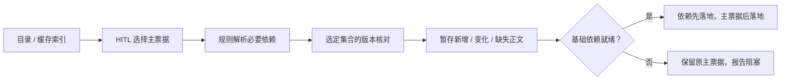

# 飞书项目票据上传与导入

Status: implemented-locally

## 目标与技能边界

提供两项配套技能，保持 setup-drdandan-skills 的工程目录和 Markdown 正文格式：

- `lark-push-tickets`：将用户指定范围的本地项目票据上传或更新为飞书在线子文档，建立依赖导航并维护母文档索引。
- `lark-pull-tickets`：由 HITL 选择主票据，自动补齐其必要基础依赖，再导入本地；不自动拉取项目内所有变化票据。

本地与飞书均可编辑。普通判断由明确规则和脚本执行；Agent 负责理解用户给出的范围、展示结果，以及收集 HITL 的选择。HITL 只决定主票据和冲突、未声明依赖等异常，不参与日常版本、路径、依赖闭包的机械判断。

用户已确认设计并授权实施。两项技能及共享规则脚本已经编写并安装，setup 源码与安装副本已加入配套约定；新技能源码所在项目没有初始化 Git，当前未写入飞书。

## 术语与本地目录

票据是项目文档，不是财务票据。“访谈记录”指 grill 类技能的澄清产物，可能是 spec、CONTEXT 或 ADR，不要求逐字访谈文本；不新增统一的 interviews 目录。

| 产物 | 本地路径 | 同步约定 |
| --- | --- | --- |
| 执行标准 / 规格 | `.scratch/<feature>/spec.md` | 保持原正文 |
| 实施票据 | `.scratch/<feature>/issues/<NN>-<slug>.md` | 一票一文件，保留 Status、Blocked by 和验收项 |
| 探索地图 / 其它项目 Markdown | `.scratch/<effort>/map.md` 等 | 不读取内部同步缓存 |
| 领域术语 | 根 `CONTEXT.md` | 仅词汇表，不混入讨论记录或实现说明 |
| 多领域关系 | 根 `CONTEXT-MAP.md` | 相关领域的 CONTEXT 通过明确依赖纳入 |
| 架构决策 | `docs/adr/*.md` | 保留编号和内容 |
| 工作台账 | 根 `TODO.md` | 保留原有任务字段与状态 |
| setup 工程配置 | `docs/agents/`、`AGENTS.md` 等 | 由目标项目的 setup 维护，不从飞书覆盖 |
| 内部状态 / 暂存 | `.scratch/.feishu-sync/` | 排除上传、目录选择和依赖声明 |

实际默认路径是 `.scratch/` 和 `docs/`，不是 `.scatch/` 或 `.docs/`。允许单文件、功能目录或上述整体内容作为上传范围。导入新项目先要求已有 setup 约定；根 TODO 等已有文件仍按冲突规则处理。

多领域项目沿用 setup 的布局声明。只有被布局允许、且被明确依赖引用的领域 CONTEXT / ADR 路径可纳入，不能据此开放任意 src 文件。

## 飞书结构与文档协议

一个项目绑定一个知识库根节点，该节点上的母文档是项目索引页。每篇本地 Markdown 对应一篇独立在线子文档，知识库层级对应本地目录；母文档不导入为票据。

母文档列出分类、相对路径、子文档链接和已验证同步结果。索引管理区由技能维护，用户在其外添加的项目说明保留；索引不是正文内容或版本号的权威来源。

每篇票据子文档按固定顺序包含三个区域：

1. 同步元信息：正文头部可见的 JSON 代码块，供确定性解析。
2. 基础依赖导航：由 requires 自动生成的可点击文档链接。
3. 票据正文：本地 Markdown 的内容；此区域在双端同步。

头部示例：

```json
{
  "schema": "feishu-ticket/v1",
  "path": ".scratch/login/issues/01-login.md",
  "requires": [
    ".scratch/login/spec.md",
    "CONTEXT.md",
    "docs/adr/0001-authentication.md"
  ]
}
```

`path` 是项目内相对路径；远端文档 token 标识已有文档，标题仅用于显示。导入移除元信息、生成的依赖导航和传输分区标题，只保存原票据正文。

无有效标识的文档、母文档以及图片、PDF、Word 等附件不导入。资料放独立资料节点，票据正文可以保留参考链接但不下载附件。正文内出现无法可靠转换的嵌入资源或格式时阻断该文件，不能默默丢弃或改写。

修改标题不改变映射；已绑定 token 的头部 path 改变视为待处理路径变更，不自动搬移本地文件。标识被移除、版本不支持、路径重复或不合法时报告，不能猜测新路径。

## 依赖规则

依赖清单是依据，子文档关系和可点击链接用于导航；不让 Agent 从普通链接或正文语义猜测必要依赖。

- 实施票据自动依赖同功能 spec；已明确声明的 Blocked by 票据按编号或路径精确解析。
- 项目已有并登记的根 CONTEXT / CONTEXT-MAP 是基础资料；不存在时不虚构，显式 requires 指向缺失文件则失败。
- 其它 ADR、前置票据等通过明确的 requires 路径声明，或在本地专门的基础依赖章节使用相对路径链接声明。
- 上传将结构关系、可明确解析的本地声明和已有同步依赖合并、去重，生成远端 requires 与链接；无法唯一解析的声明需补正，不能忽略。
- 拉取按当前选定文档的声明递归建立依赖闭包，公共依赖只处理一次；循环必要依赖、重复路径或目标不明确时报告阻塞。
- 只处理绑定项目内的依赖。必要依赖位于项目外时阻塞；普通外部参考链接保留为文字链接，不自动导入。
- 不修改原票据的执行状态。资料依赖就绪不代表 Blocked by 对应任务已执行完成。

选定主票据意味着授权补齐其规则确定的基础依赖，不为每个新增依赖重复请求许可；运行摘要明确列出补入文件。

## 上传流程

1. 读取目标项目的 setup 约定和飞书绑定；用户已指定文件或目录时沿用。范围不明确时展示可上传范围并一次确认。
2. 在允许范围中扫描本地 Markdown，生成确定的依赖清单；把必要本地基础文件纳入本次计划。
3. 读取母文档索引和已有映射，解析知识库 node_token 与文档 obj_token；复用已有节点和文档，不根据标题盲目新建。
4. 按本地基线与远端轻量版本检查变化。无变化跳过；远端未拉取的改动或双端改动不直接覆盖。
5. 先保证依赖在远端存在且已验证，再创建或更新对应票据，生成有效依赖链接。
6. 复用 lark-cli 和公开 docx 转换/嵌套块接口执行 native block diff，不默认全文 overwrite；只更新管理区和本次需要改变的正文，保留未变化块的 ID 和其它内容。使用基准 revision、操作标识，先插入再移除旧块，并验证 API 和回读结果。
7. 写后回读并检查关键正文、元信息与依赖链接，按文件记录已验证结果；再更新母文档索引。

创建请求超时且结果不明时先记录未确定状态并核对目标节点，不自动再创建一篇。只有确定的暂时网络/服务错误才有限重试；权限、标识及结构错误直接报告。

## HITL 导入流程与增量读取



1. 用母文档索引和分页目录元信息展示候选文件；不先读取所有票据正文。用户已给出具体路径或链接时视为已完成选择。
2. 只针对选定主票据及必要依赖读取轻量 revision；秒级编辑时间只能提示疑似变更，不能代替精确版本判断。
3. 选定票据首次读取或发生版本变化时解析其头部依赖；新依赖按同一规则扩展闭包。未选择且不构成依赖的正文不得读取。
4. 版本未变且本地文件存在、内容匹配已同步基线时直接复用。新文件、正文版本变化或本地缺失时才读取必要正文；失效元信息不能直接认定未变化。
5. 将正文保存到内部暂存区，提取管理元信息，校验路径、内容与依赖。远端发生并发变化时重新核对，不直接使用陈旧计划。
6. 本地文件有未同步修改、双方同时修改、或首次配对时已有不同内容，展示正文 diff，由 HITL 选择保留本地、使用远端或人工合并；常规无冲突文件按规则处理。
7. 依赖全部写入并验证后才写入对应主票据。任一必要依赖缺失、无权限、转换失败或冲突未解决，原主票据保持原样；其它独立组继续。
8. 每个文件落地验证成功后才更新基线；依赖组全部成功才报告该主票据导入成功。基础依赖本地内容有改动时需明确保留或解决，不能仅凭版本相同认为就绪。

首次导入另一个项目也由 HITL 选择，不默认恢复全部票据。已有目录/文件被保留；非必要文件不覆盖。

## 本地配置、状态与冲突边界

`docs/agents/feishu-sync.md` 记录协议、允许路径、母文档/项目入口和处理约定，首次同步前可以未绑定；不含账号凭据。

`.scratch/.feishu-sync/` 保存项目绑定下的路径/token 映射、已验证 revision、本地与远端各自的正文 hash、已知依赖、暂存及按文件结果。两端 hash 分别比较各自上次基线，不把 docx 转换后的字节差异误判为双端编辑。状态与暂存不上传，不作为普通票据依赖。

每次操作保留明确的成功、跳过、冲突、失败与阻塞结果。部分成功保留；失败和冲突不得推进该文件的已同步基线。目录分页不完整、权限失败或未知状态不是删除依据。

第一版只新增/更新，不自动删除、搬移或跨项目导入。状态丢失或损坏不能偷偷退回全项目正文读取；需明确建立所选范围的基线。

头部路径视为数据：禁止绝对路径、盘符/UNC、父目录逃逸、保留配置目录、符号链接/重解析点逃逸、Windows 不合法或大小写冲突路径。校验后的目标必须仍在本地项目根中。

## 与 setup 的最小配套改动

- 在 setup 的输出清单、预览、写入和完成说明中加入 `docs/agents/feishu-sync.md`，并提供对应种子模板。
- 在生成的 AGENTS 技能入口里加入上传/导入入口和同步约定引用；此处只记录使用规则，不把 AGENTS 同步到飞书。
- 合并 `.gitignore` 的 `.scratch/.feishu-sync/` 规则，保留已有忽略规则。
- setup 不要求当场飞书登录或绑定，不改变 issue tracker；已有项目可以由首次调用添加缺失的配套约定，不必重跑 Git identity 等完整 setup。
- 真正源码位于 `D:\张舒扬\博士\开发项目\Skill-project\setup-drdandan-skills\skills\setup-drdandan-skills`。以源码为基础，对安装副本仅同步本次必要改动，保留两者已有的实验目录增强，不整包覆盖。
- 按需更新 setup 的中英文 README；不修改 to-spec、to-tickets、domain-modeling 等消费技能。

两项新 Skill 编排已有 lark-cli，规则脚本使用 Python 3.9+ 标准库。共用协议与脚本资源，不增加第三个技能、额外 MCP、后台订阅或新依赖。配套后台启动器支持中文、空格和方括号路径，并保存进度/失败/结果，项目工作锁防止并发修改共享状态。

## 验收场景

| 场景 | 必须结果 |
| --- | --- |
| 重复上传同一票据 | 复用原 token，不重复创建文档 |
| 1,000 篇票据，HITL 选 2 篇 | 正文读取限于这 2 篇与其实际必要依赖 |
| 所选集合及本地基线都未变 | 正文读取次数为 0 |
| 本地缺失已同步的基础文件 | 必要时读取并修复该依赖，再导入主票据 |
| 两篇主票据共用 spec / CONTEXT | 公共依赖不重复拉取 |
| 依赖缺失、转换失败、权限不足或冲突 | 主票据不覆盖，不报告依赖组成功 |
| 部分文件失败 | 其它独立组可以完成；失败文件保留重试状态 |
| 新项目已有 TODO / CONTEXT 等 | 差异确认后才覆盖，不绕过本地冲突 |
| 标识无效、母文档、附件、越界路径 | 不写入本地票据目录 |
| 根元信息和生成导航 | 不出现在导回的票据正文 |
| 标题改名、路径变更或目录分页未完成 | 不盲目新建、搬移或删除 |
| 中文、空格、CRLF、代码块、状态与验收项 | 导入可供已有工程技能使用；转换不可靠时报告 |
| 远端修改发生在同一秒 | 精确 revision 检查仍发现变化，不只比较时间戳 |

实现时用离线假 CLI / fixture 验证选择边界、依赖闭包、版本跳过、基线与路径防护，再在用户授权的测试文档中核对 Markdown 往返、局部更新、旧 revision 拒绝和失败语义。

## 已核对事实与尚未实测的限制

本机 lark-cli 版本为 1.0.97，28 个官方 Skills 已安装并通过文件校验。在线 docx 可以 Markdown create/fetch/update，但并不保证原文件字节和排版完全一致；导出的转义必须保留。

官方 docs 当前没有 +diff；原生 markdown +diff 不能充当在线 docx 的补丁接口。可以在本地用标准库生成正文 unified diff，但不能将其称为服务端增量补丁。

轻量文档基本信息返回 revision_id 而不返回正文。Wiki 目录需要分页递归；Drive 批量元数据最多 200 个文件，修改时间为秒级；搜索 edited-since 是当前用户编辑时间，不是所有协作者的变更游标。

旧 revision 的服务端拒绝语义尚未实测，不承诺跨多篇文档的原子快照或绝对没有并发竞态。全文 overwrite 可能丢失评论和资源，因此不能作为默认更新方式。

证据：[文档基本信息](https://open.feishu.cn/document/server-docs/docs/docs/docx-v1/document/get)、[批量元数据](https://open.feishu.cn/document/server-docs/docs/drive-v1/file/batch_query)、本机官方 lark-doc 的 fetch/update/Markdown 参考和 Wiki/Drive 的 schema。

设计共识依据：双端可编辑；在线云文档；头部标识及路径；母文档索引与独立子文档；项目内容同步而工程配置由 setup 维护；只新增/更新；逐文件保留成功；首次同步绑定；HITL 选择主票据；依赖先就绪；仅项目内依赖；其它流程尽量规则化自动完成。

## 实施记录（2026-10-12）

- 已安装 `lark-push-tickets` 和 `lark-pull-tickets` 到 `C:\Users\RIVER\.codex\skills`，setup 安装副本已同步本次必要改动。
- 16 个离线场景通过；两项新技能与 setup 的格式校验通过，模板引用及普通票据不被缓存规则忽略的行为已验证。
- 独立 forward-testing 通过脚本 CLI 入口完成 bind、plan-pull、apply-pull：只导入所选主票据及 spec、ADR；未选票据/资料不读取，重复导入正文读取为零。此验证使用 FakeLark，不代表真实 API 行为。
- 后台启动器在含中文、空格和方括号的路径上，正确记录独立 PID、时间戳和预期失败；此验证未访问飞书。
- setup 已提交并推送 `main`：[773e0be](https://github.com/Dr-DanDan/setup-drdandan-skills/commit/773e0be01961ae7925014cc82022d79b130bb9ec)。
- 未进行实际飞书文档往返或并发测试；单个改变组超过 1000 个块会安全停止，需要后续按实际大票据需求扩展批量写入。
